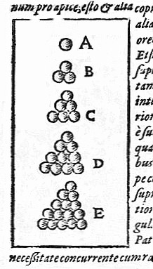

# Flyspeck

:::: columns
::: column
- 1611: Kepler conjectures
- 19xx: Several proof attempts/claims
- 1998: Hales–Ferguson announce a proof
- 2003: *Annals* is 99% certain
- 2003: Hales launches Flyspeck
- Joint work with 21 collaborators
- 2015: Formal proof is completed using Isabelle and HOL Light
:::
::: column

:::
::::
