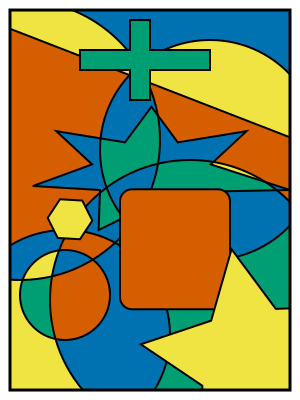

# Four colour theorem

:::: columns
::: column
- 1852: Guthrie conjectures
- 1976: Appel–Haken: proof using extensive computer calculation
- 1996: Robertson–Sanders–Seymour–Thomas: shorter proof, less cases, faster algorithm
- 2005: Gonthier–Werner formalize a proof in Rocq
:::
::: column

:::
::::
